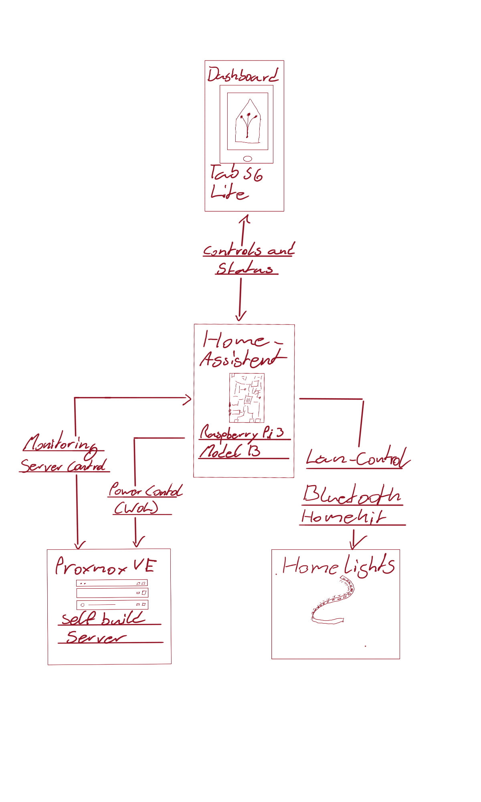

# My Homelab

Moin and Welcome to my homelab! I'm building a personal environment for self-hosted services, home automation, and hopefully some hands-on learning.

This repository documents how all my home devices can be fit together, also the decisions behind them, maybe also why i use them not all but for some, the important ones(for me :D). 

## Overview

A custom-built Proxmox server hosts my virtualized services. A separate Raspberry Pi runs Home Assistant, with a repurposed Samsung tablet as its dashboard. Keeping home automation on the Pi allows it to operate independently of the main server.

*My hand-drawn functional overview. Connections are simplified and do not represent the complete network topology.*

## Explore the Setup

- **[Proxmox server](proxmox/README.md):** virtualization, services, monitoring, and power controls.
- **[Raspberry Pi](raspberry-pi/README.md):** the separate home automation controller.
- **[Home Assistant](raspberry-pi/home-assistant/README.md):** the tablet dashboard, lighting, and server integration.

## Hardware

| Device | Role |
| --- | --- |
| Custom-built server | Proxmox VE host for virtualized services |
| Raspberry Pi 3 Model B | Home Assistant and local device integrations |
| Samsung Galaxy Tab S6 Lite | Dashboard for home controls and server monitoring |
| Govee and Nanoleaf light strips | Connected lighting |

## Services

These services are included in the documented setup. This inventory is not a live availability report.

| Service | Area |
| --- | --- |
| [Home Assistant](raspberry-pi/home-assistant/README.md) | Home automation and dashboard |
| [Dashy](proxmox/services/dashy.md) | Dashboard |
| [Pelican Panel and Wings](proxmox/services/pelican.md) | Game server management |
| [VS Code](proxmox/services/vscode.md) | Development tools |
| [Nginx Proxy Manager](proxmox/services/nginx-proxy-manager.md) | Reverse proxy management |
| [cloudflared](proxmox/services/cloudflared.md) | Connectivity infrastructure |

See the [Proxmox service index](proxmox/services/README.md) for documentation status and open questions.

## Progress and Learning

Previous setup work established a tablet dashboard, Proxmox monitoring, server power controls, local lighting integrations, and Home Assistant configuration backups. I am learning about virtualization, device integration, dashboard design, and troubleshooting through this project.

These are documented results from earlier setup sessions, rather than fresh checks of the running systems. A complete server shutdown-and-wake cycle still needs final verification, and Bluetooth reliability remains an improvement area.

## Things i try to work on and ideas

- [ ] Verify the complete server power cycle.
- [ ] Improve Bluetooth reliability on the one lightstrip.
- [ ] Refine dashboards and automations.
- [ ] Explore a smart mirror as an additional display.

## About This Documentation

This is a growing personal project. Working features, known limitations, and planned work are distinguished on the relevant pages.

Public diagrams and descriptions are simplified. Credentials, real device addresses, deployment domains, tunnel mappings, private configurations, and backups are excluded. Configuration examples may be added in a later stage.
