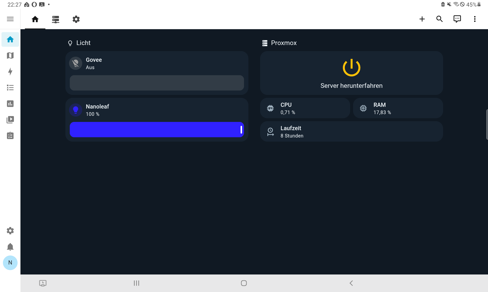
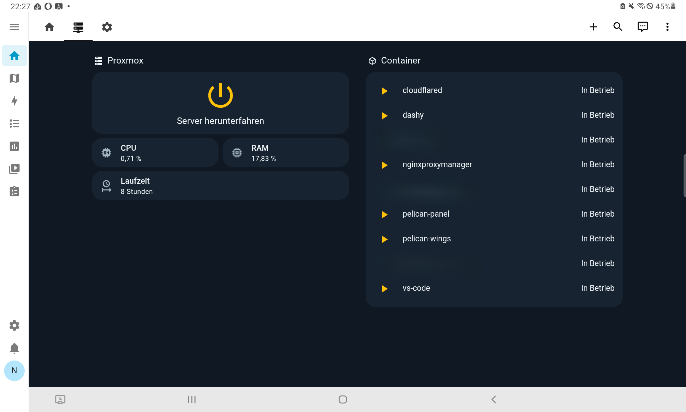
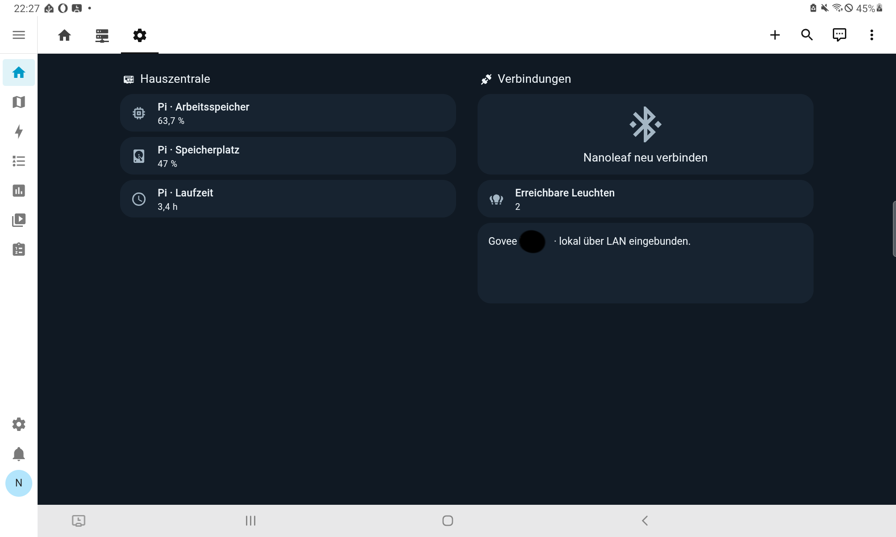

# Home Assistant

[Home](../../README.md) · [Raspberry Pi](../README.md) · [Proxmox server](../../proxmox/README.md)

Home Assistant brings home controls and server information into one tablet interface. It runs in Docker on the Raspberry Pi, separately from the Proxmox host.

## Tablet Dashboard

The Samsung Galaxy Tab S6 Lite uses the Home Assistant Companion app as a control panel. Android was retained; rooting or flashing the tablet was not required.

The dashboard has home, server, and system views, with controls and status information grouped by purpose.

## Dashboard Screenshots

These screenshots show the dashboard on my tablet in German. The public YAML is a simplified English version of this setup.

### Home

Lighting controls and an overview of the Proxmox server.

### Server

Proxmox resource readings and container status at a glance.

### System

Pi system readings, light availability, and the Nanoleaf reconnect control.

## Dashboard YAML

[ui-lovelace.yaml](ui-lovelace.yaml) is a public example adapted from my tablet dashboard, with Home, Server, and System views. Labels are in English and entity IDs use neutral example names. It uses the included Homelab theme.

Supporting configuration is included below. The UI integrations still need to be connected to your own devices.

| Example entity | Role |
| --- | --- |
| `light.govee_strip` | Govee light |
| `light.nanoleaf_strip` | Underlying Nanoleaf light |
| `light.nanoleaf_controls` | Light entity used by the Nanoleaf control card |
| `input_select.nanoleaf_connection` | Connection helper with a `Ready` option |
| `script.nanoleaf_reconnect` | Nanoleaf reconnect action |
| `binary_sensor.proxmox_online` | Server reachability |
| `script.proxmox_start` / `script.proxmox_shutdown` | Server power actions |
| `sensor.proxmox_*` | CPU usage, memory usage percentage, and uptime |
| `binary_sensor.*_status` | Status of each listed Proxmox service |
| `sensor.pi_*` / `sensor.available_lights` | Pi system readings and light availability |

Replace the example entity IDs throughout the file before using it as a YAML dashboard or pasting it into the dashboard's raw configuration editor. The Nanoleaf helper and its reconnect script must agree on the English `Ready` state. The dashboard includes a confirmation prompt for server shutdown.

Changes to these repository examples do not update the dashboard running on my tablet.

## Supporting Configuration

| File | Contents |
| --- | --- |
| [configuration.yaml](configuration.yaml) | Dashboard registration, includes, system sensors, light count, Wake-on-LAN, and shutdown REST command |
| [scripts.yaml](scripts.yaml) | Server power actions and Nanoleaf reconnect logic |
| [packages/nanoleaf.yaml](packages/nanoleaf.yaml) | Connection helper and guarded Nanoleaf light |
| [packages/proxmox-recovery.yaml](packages/proxmox-recovery.yaml) | Proxmox monitoring recovery automation |
| [themes.yaml](themes.yaml) | Homelab dark theme |
| [secrets.example.yaml](secrets.example.yaml) | Invented placeholders for local credentials and connection details |
| [integrations.md](integrations.md) | Integration setup, entity mapping, and instructions for using the examples |

The examples use English names throughout. Create your own local `secrets.yaml` from the example; it is excluded from Git. Proxmox, Govee, and HomeKit Device are configured through Home Assistant's UI.

## Proxmox Integration

The server integration brings these controls and readings to the tablet:

- CPU, memory, uptime, and container status displays.
- Wake-on-LAN configured for server startup.
- A shutdown control with a confirmation prompt.
- A power button whose action follows the reported server state.
- Resource displays shown only when the server is reachable and measurements are available.

## Lighting

| Device | Connection | Controls |
| --- | --- | --- |
| Govee light strip | Local LAN control | Brightness |
| Nanoleaf light strip | HomeKit over Bluetooth | Switching and dimming |

Govee uses the local LAN integration. The Nanoleaf controls include a reconnect button and connection feedback.

## Configuration Backups

Home Assistant configuration backups are stored on both the Pi and PC. They contain private configuration and integration data and stay outside this repository.
